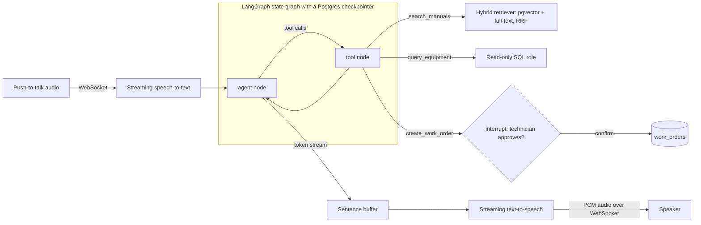

# Maintenance Voice Agent

A hands-free assistant for plant maintenance technicians. A technician holds one button and asks a question out loud, for example "What torque do I use on the HX-200 impeller nut?" or "Which pumps in Alexandria are overdue for service?". The agent searches the equipment manuals and the equipment register, then answers out loud while the text streams on screen with citations. It can also log a work order, but only after the technician confirms it by voice or with a button.

Technicians usually have gloves on and both hands busy, which is why the main interface is voice and not a chat box.



## How it works

- **Agent graph (LangGraph).** A `StateGraph` with an `agent` node (a LangChain chat model with tools bound) and a prebuilt `ToolNode`, connected by `tools_condition`. A `RemainingSteps` guard switches the model to `tool_choice="none"` before the step limit, so every turn ends with an answer instead of an error. The history sent to the model is cut with `trim_messages` on whole turns, so tool calls and their results are never split.
- **Conversation memory.** `AsyncPostgresSaver` checkpoints every thread in PostgreSQL. A technician can ask "Is it running?" right after asking about P-101, and the session survives restarts.
- **Human in the loop.** `create_work_order` checks that the equipment tag exists, then calls LangGraph's `interrupt()`. The graph pauses with the proposed work order saved in the checkpoint. It resumes with `Command(resume=...)` when the technician says "confirm" or clicks Approve. Anything other than a clear confirmation cancels it, and nothing is written until then.
- **Retrieval (LangChain).** PDF pages are split with `RecursiveCharacterTextSplitter` (120-word chunks, 30-word overlap) and embedded with `OpenAIEmbeddings`. `HybridRetriever` is a LangChain `BaseRetriever`: one SQL query runs a pgvector cosine search (HNSW index) and a PostgreSQL full-text search (GIN index), then merges the two rankings with reciprocal rank fusion. Keyword search catches model numbers and tags, and vector search catches paraphrased questions.
- **Safe SQL tool.** Model-written SQL runs as the `agent_reader` role, which can only `SELECT` from `equipment` and `work_orders`. Each query runs in a transaction that is always rolled back, with read-only mode, a 3-second statement timeout, one statement per call, and at most 50 rows. Database errors go back to the model so it can fix its query.
- **Voice pipeline.** The browser records one utterance and sends it over a WebSocket. Speech-to-text streams transcript deltas back while it decodes. The prompt includes equipment vocabulary such as HX-200 and P-101. The agent's tokens stream to the screen and into a sentence buffer. Each finished sentence goes to streaming text-to-speech, so the first sentence plays while later ones are still being generated. Audio returns as 24 kHz PCM and plays through the Web Audio API. Citations and markdown are shown on screen but removed from the spoken text.
- **Barge-in.** Pressing the talk button while the agent is speaking stops playback at once. The server stops sending audio for that turn but lets the graph finish, so the saved conversation state stays consistent.

## Run it

Requirements: Docker and an API key for OpenAI or Azure OpenAI.

```bash
cp .env.example .env          # add your key; change CHAT_MODEL if you like
docker compose up -d --build
docker compose exec api python -m app.retrieval docs
```

Open `http://localhost:8000`, allow the microphone, and hold the button (or the space bar) to talk. You can also type.

For Azure OpenAI, set `OPENAI_BASE_URL=https://<resource>.openai.azure.com/openai/v1/` and use your deployment names for `CHAT_MODEL` and `EMBED_MODEL`. The embedding model must support 1536 dimensions, for example `text-embedding-3-small`. The speech models are set in `app/config.py`.

## API

| Method | Path | Purpose |
| --- | --- | --- |
| `GET` | `/search?q=` | Hybrid search over the manuals |
| `POST` | `/threads/{id}/messages` | Ask a question in text; returns the answer, sources, SQL queries, and any pending approval |
| `POST` | `/threads/{id}/approval` | Approve or cancel a pending work order: `{"approved": true}` |
| `WS` | `/threads/{id}/voice` | Voice turns: send audio, receive transcript and answer events plus PCM audio |

Voice events from the server: `transcript.delta`, `answer.delta`, `approval`, `turn.done` (with sources and queries), and `error`. Binary frames are 16-bit mono PCM at 24 kHz. Send any text frame, such as `{"type": "stop"}`, to stop speech.

## Tests and evaluation

```bash
docker compose up -d db
docker compose run --rm api python -m pytest -v -rs
```

The tests run against a real PostgreSQL database with pgvector, using a scripted chat model and fake speech services. They cover:

- hybrid search ranking and recall@5 on the evaluation set
- answers with citations from the search tool
- memory across turns
- the SQL tool's restrictions: writes, other tables, server files, multiple statements, and timeouts are all blocked
- the approval flow through both REST and voice, including cancellation and unknown equipment tags
- the step limit
- sentence splitting and citation removal for speech
- streaming of transcript, text, and audio over the WebSocket
- input validation

`test_eval_with_real_models` runs when `OPENAI_API_KEY` is set. It re-indexes the manuals with real embeddings and asks the agent all 20 questions in `eval/questions.jsonl`. It fails if retrieval recall@5 falls below 90%, or if fewer than 80% of answers cite the expected file and page. In GitHub Actions, add `OPENAI_API_KEY` as a repository secret to run it.

## Repository layout

| Path | Contents |
| --- | --- |
| `app/agent.py` | Tools, LangGraph state graph, approval interrupt, and turn summary |
| `app/retrieval.py` | PDF ingestion and the hybrid LangChain retriever |
| `app/voice.py` | Streaming speech-to-text and text-to-speech, sentence buffering, and confirmation parsing |
| `app/main.py` | FastAPI app: REST endpoints and the voice WebSocket |
| `static/index.html` | Push-to-talk web client |
| `schema.sql` | Chunks with vector and full-text indexes, equipment register, work orders, and the read-only role |
| `docs/`, `eval/` | Sample manuals and 20 evaluation questions with the expected file and page |

The manuals and equipment data are fictional and were written for this project, so the expected evaluation answers are known exactly. They are shared with [engineering-knowledge-rag](https://github.com/Yahiasherif002/engineering-knowledge-rag), the text-only version of this assistant, which is built on the OpenAI SDK without a framework.
